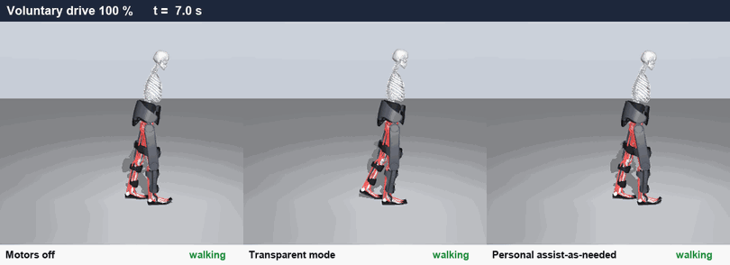
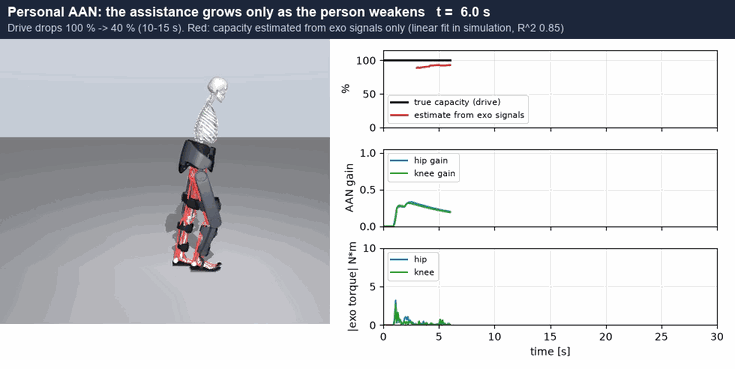

# indego_aan

Personalised assist-as-needed control for the Indego exoskeleton. The controller learns a person's own gait and adds
torque only when they can no longer produce it themselves, for example when their voluntary drive drops or their
muscles fatigue. It is developed in [indego_sim](https://github.com/AmirhosseinAsadi1380/indego_sim), a
muscle-driven simulation of a person wearing the Indego, and checked against recordings of real Indego users.

<p align="center">
  
</p>
<p align="center"><em>Voluntary drive drops to 40 %: with the motors off or in transparent mode the person falls; with
personal assist-as-needed they keep walking.</em></p>

<p align="center">
  
</p>
<p align="center"><em>Assistance stays near zero while the person is fresh and rises as they weaken; the exo's own
signals track the person's remaining capacity.</em></p>

## Overview

- **Simulated users who weaken:** loss of voluntary drive and muscle fatigue on an 80-muscle human model.
- **Personal assist-as-needed controller:**
  - uses only the exoskeleton's joint encoders;
  - assists only when the gait leaves the person's own normal variability.
- **Capacity estimate:** the person's remaining strength, inferred from onboard signals alone.
- **Evaluation:**
  - benchmarks against standard and reinforcement-learning controllers;
  - comparison with real people walking in an Indego.
- **Learned human models:** a muscle-driven imitation policy (KINESIS) walking in the exoskeleton (in progress).

Results so far come from simulation and from replaying recorded data; the controller has not yet been tested on
people.

## Installation

```bash
git clone https://github.com/AmirhosseinAsadi1380/indego_sim
git clone https://github.com/MyoHub/myo_sim
pip install -e indego_sim && pip install --no-deps -e myo_sim

git clone https://github.com/AmirhosseinAsadi1380/indego_aan
cd indego_aan && pip install -e ".[all]"
python -m pytest -q tests
```

## Usage

```bash
python scripts/baselines.py           # controllers under weakness and fatigue
python scripts/deficit_estimate.py    # capacity estimate from the controller's signals
python scripts/showcase.py            # the animations above
```

Real-data comparisons take the [Waterloo Indego dataset](https://doi.org/10.6084/m9.figshare.24910953) folder as an
argument (`scripts/waterloo_indego.py`, `scripts/paan_real_replay.py`). The learned human is set up as described in
[scripts/kinesis](scripts/kinesis/README.md).

## Repository

| | |
|---|---|
| `indego_aan/` | controller, deficit models, scenario, metrics, training environment, data readers |
| `scripts/` | experiments and figures |
| `scripts/kinesis/` | learned human: policy server, training and evaluation tools |
| `results/` | the numbers behind the results (no trained-policy binaries) |
| `docs/` | [sensors](docs/SENSORS.md), [third-party sources and licences](docs/SOURCES.md) |

Third-party datasets and body models are downloaded separately and never redistributed here.
