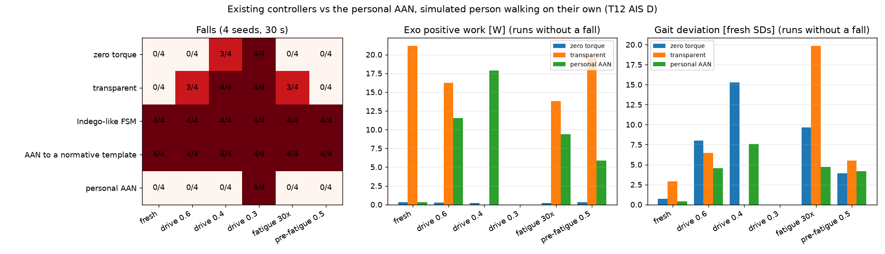
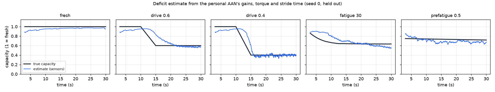
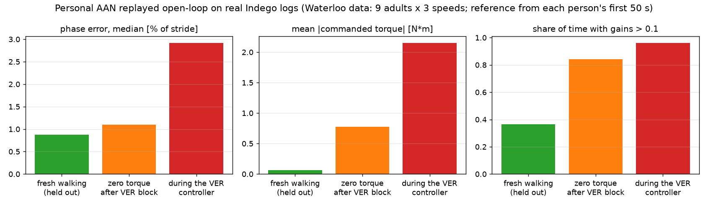
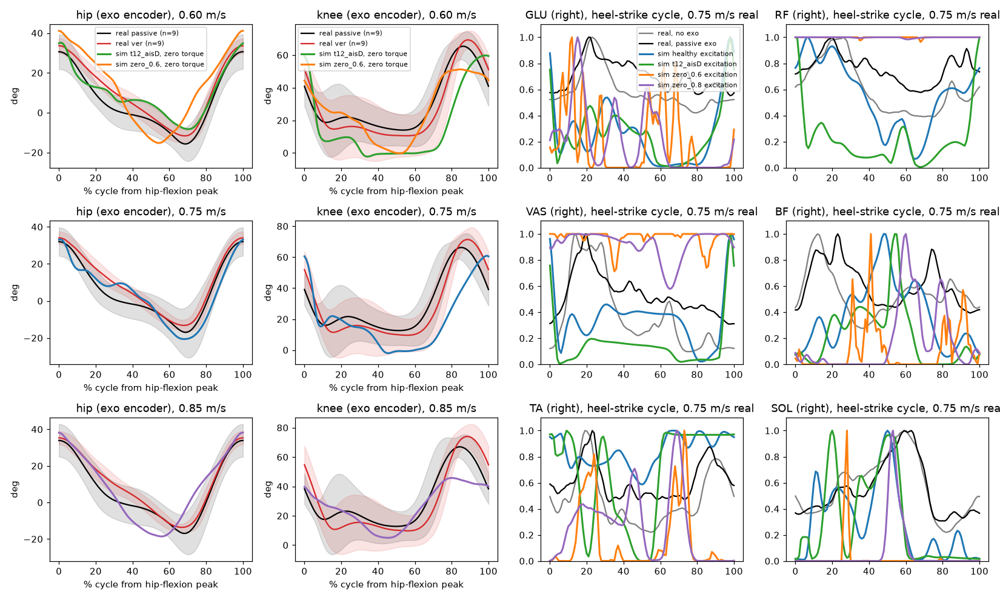
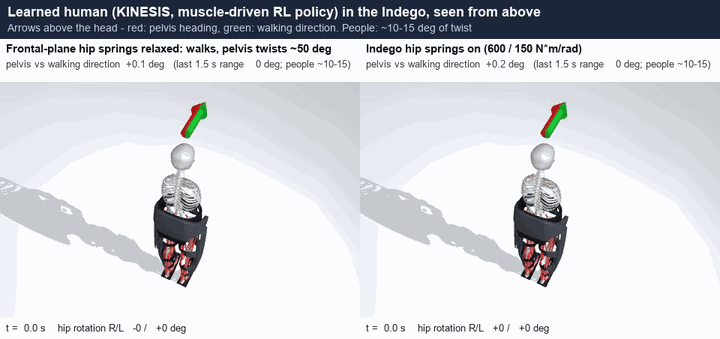
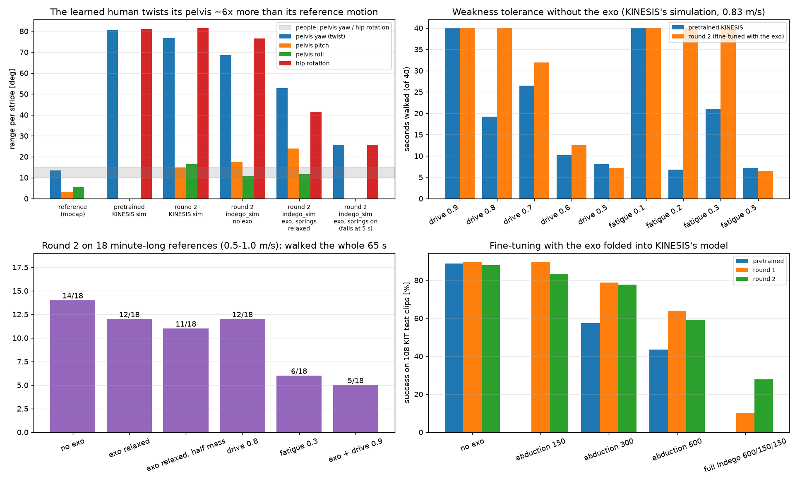

# indego_aan

Personalised **assist-as-needed control** for the Indego lower-limb exoskeleton: a controller that keeps a person
walking close to *their own* normal gait when their voluntary drive drops or their muscles fatigue, and adds only the
torque they are missing. Developed and stress-tested in [indego_sim](https://github.com/AmirhosseinAsadi1380/indego_sim),
a MuJoCo simulation of an 80-muscle human wearing the Indego, and checked against recordings of real people walking in
an Indego.

<p align="center">
  
</p>

*A simulated person with an incomplete spinal cord injury walks on their own in the Indego. Between 10 and 15 s their
voluntary drive drops from 100 % to 40 %. Same person, same random seed, three exo controllers: with the motors off
and in transparent mode they fall; with the personal assist-as-needed controller they keep walking, and the exo adds
torque only after the drop.*

## Highlights

| | result |
|---|---|
| Falls under weakness (4 seeds, 30 s) | **none** down to 40 % voluntary drive, under accumulating fatigue and with pre-fatigued extensors; zero torque falls 3/4 and transparent mode 4/4 at 40 % drive |
| Assistance when it is not needed | **~0 W** of exo work for a fresh person (transparent mode: ~21 W) |
| The person keeps working | **86-94 %** of the hip + knee positive work is still done by the person under deficits |
| Capacity from onboard sensors only | linear estimate from the controller's own signals: **R² = 0.85**, RMSE 0.08, 2-3 strides behind a drive drop |
| On real Indego logs (9 adults, 3 speeds) | gait-phase error **0.9 %** of the stride (median); ~0.06 N·m for fresh walking it was not fitted on |
| Learning-based controllers | four PPO variants and a CMA-ES-tuned privileged controller did **not** beat it |

All results are from simulation or open-loop replay of recorded data; the controller has not run on people yet.

## How it works

**The controller** (`indego_aan/controllers.py`) needs only the Indego's joint encoders. A short walk with the motors off
gives the person's own gait: the mean hip and knee curves over the stride and their step-to-step spread. While
walking, it:
1. finds the gait phase by matching the current encoder angles and velocities to that cycle;
2. stays silent while the joints are within two standard deviations of the person's own curve;
3. when they leave that band, raises an impedance toward the person's own trajectory, and lets it decay again when
   they recover (up to 40 N·m).

**Simulated weakness** (`indego_aan/deficits.py`):
- volitional drive with drift and lapses;
- per-muscle three-compartment fatigue (3CC-r, MyoSuite parameters);
- pre-fatigued muscle groups, calibrated against the DUO-GAIT fatigue dataset.

**Metrics** (`indego_aan/metrics.py`), one for each success criterion:
- gait deviation, in units of the person's fresh variability;
- exo work and torque;
- the human's share of the joint work.

### Assistance follows the loss of capacity

<p align="center">
  
</p>

The controller's adapted gains rise only as the person weakens. Together with its torque and stride time, they give
an estimate of the person's remaining capacity (red) from exo signals alone: a candidate fatigue/volition monitor that
needs no extra sensors. The same signals do *not* reliably tell low drive from fatigue (83 % on held-out seeds, but
8-36 % on an unseen severity), so that distinction needs EMG or other sensors.

<p align="center"></p>
<p align="center"></p>

### Checked against real people in an Indego

The [Waterloo Indego dataset](https://doi.org/10.6084/m9.figshare.24910953) is the only public dataset of people
walking in an Indego: 9 healthy adults on a treadmill at 0.60, 0.75 and 0.85 m/s, with exo logs, motion capture,
ground forces and EMG.
- `indego_aan/waterloo.py` reads it and reproduces the paper's kinematic results.
- It shows what wearing the Indego does to healthy gait: pelvis rocking triples, and the thigh IMU leads the encoders
  by ~50 ms.
- It quantifies where the simulated people still differ from real ones.

Replaying the logs through the controller open-loop shows that its phase estimate follows real gait and that it stays
quiet for fresh walking.

<p align="center"></p>
<p align="center"></p>

### A learned, muscle-driven human in the exo (in progress)

The simulated person above has a hand-tuned walking controller. To get a person who adapts, the pretrained
[KINESIS](https://github.com/amathislab/Kinesis) motion-imitation policy was used:
- it drives the same 80-muscle model;
- it runs inside indego_sim through a policy server;
- it was fine-tuned with the exo folded into its own training model.

With the Indego's frontal-plane hip springs relaxed, it now walks for a minute at 0.5-1.0 m/s in the exo, with a
realistic cadence (stride 1.40 s vs 1.43 s in real Indego users).

<p align="center">
  
</p>

The evaluation also found a flaw that standard imitation metrics miss.
- **The flaw:** KINESIS rewards only *where* the pelvis, knees, ankles and toes are, not how they are oriented.
- **What the policy does:** it twists the pelvis by 75-80° per stride (its reference motion: 13°) and compensates
  with hip rotation from one joint limit to the other.
- **Why it matters here:** the Indego's frontal-plane hip springs resist that twist, so the policy falls with them on
  (right) and walks with them relaxed (left).
- **What's next:** training with pelvis-orientation tracking is under way.

<p align="center"></p>

## Installation

Python 3.10+.

```bash
# 1. the simulation and its MyoLeg model
git clone https://github.com/AmirhosseinAsadi1380/indego_sim
git clone https://github.com/MyoHub/myo_sim
pip install -e indego_sim && pip install --no-deps -e myo_sim

# 2. this package, after indego_sim (extras: rl = PPO teacher, tune = CMA-ES, viz = figures and animations, test)
git clone https://github.com/AmirhosseinAsadi1380/indego_aan
cd indego_aan && pip install -e ".[all]"
python -m pytest -q tests
```

The scripts start one worker per physical core with single-threaded BLAS, capped by free memory
(`indego_aan/resources.py`). The Indego meshes are not included (commercial 3D model). The simulation runs without
them, with mass-equivalent shapes.

## Quick start

```bash
python scripts/fresh_reference.py               # the simulated person's own fresh gait (the controller's reference)
python scripts/baselines.py                     # controllers x deficits -> results/baselines.json
python scripts/deficit_estimate.py              # capacity estimate from the controller's signals
python scripts/showcase.py                      # the animations and figures above -> docs/media/
```

With the Waterloo data downloaded into a folder of your choice:

```bash
python scripts/waterloo_indego.py <folder> --simulate   # real people in the Indego vs the simulated people
python scripts/paan_real_replay.py <folder>             # the controller replayed on the real exo logs
```

The learned human needs a KINESIS checkout and its data; see [scripts/kinesis/README.md](scripts/kinesis/README.md).

## Repository

| path | contents |
|---|---|
| `indego_aan/scenario.py`, `humans.py` | the base scenario: a person walking on their own in the Indego (sagittal model) |
| `indego_aan/deficits.py` | low volitional drive, 3CC-r fatigue, pre-fatigue |
| `indego_aan/controllers.py` | the personal assist-as-needed controller |
| `indego_aan/rollout.py`, `metrics.py` | instrumented rollouts and the success metrics |
| `indego_aan/env.py` | Gymnasium environment for training controllers (privileged observations, deficit randomisation) |
| `indego_aan/waterloo.py` | reader and gait analysis for the Waterloo Indego dataset |
| `indego_aan/kinesis_human.py` | the KINESIS policy as the simulated person in indego_sim |
| `scripts/` | experiments: deficit sweeps and calibration, baselines, teacher training (PPO, CMA-ES), capacity estimate, drive-vs-fatigue classification, real-data comparison and replay, learned human under deficits, figures |
| `scripts/kinesis/` | KINESIS integration: policy server, exo and deficit training wrapper, long walking references, evaluation and gait checks |
| `results/` | the numbers behind this README (JSON), learning curves and run settings; no trained-policy binaries |
| `docs/` | [sensors a deployable controller may use](docs/SENSORS.md), [third-party sources and licences](docs/SOURCES.md) |

Scripts and docstrings refer to the project's stages:
- 0: simulation throughput;
- 1: a realistic, adaptable human;
- 2: deficit models;
- 3: the human's objective;
- 4: a privileged teacher controller;
- 5: a deployable controller and capacity estimate;
- 6: validation with people (planned).

## Data and licences

Third-party data and body models are downloaded by the user and never redistributed here. Only derived summary numbers
are in `results/`.
- **DUO-GAIT** (Zenodo 10.5281/zenodo.7415758): `processed.zip`, unzipped into `data/duo_gait/`.
- **Waterloo Indego dataset** (Nasiri et al., PLOS ONE 2025, CC BY 4.0; Figshare 10.6084/m9.figshare.24910953): any
  folder, passed to the scripts.
- **KINESIS** (BSD-3-Clause), **SMPL** and **AMASS/KIT**: registration-only, set up as described in
  `scripts/kinesis/README.md`.

Details and the reasons for each choice are in [docs/SOURCES.md](docs/SOURCES.md).

## Limitations

- Controller results come from simulation and open-loop replay. The controller has not yet been tested on people.
- The hand-tuned simulated person is sagittal-plane and stiffer than people (higher cadence, straight knee in stance).
- The learned person is more realistic in timing but twists its pelvis, and it is less tolerant of weakness. Both are
  being addressed in training.
- The capacity estimate is validated in simulation only.

## Acknowledgements

Built on [MuJoCo](https://mujoco.org), [MyoSuite](https://github.com/MyoHub/myosuite) (MyoLeg, 3CC-r fatigue
parameters), [KINESIS](https://github.com/amathislab/Kinesis), [Stable-Baselines3](https://github.com/DLR-RM/stable-baselines3),
the [Waterloo Indego dataset](https://doi.org/10.1371/journal.pone.0292334) and
[DUO-GAIT](https://doi.org/10.1038/s41597-023-02391-w).
